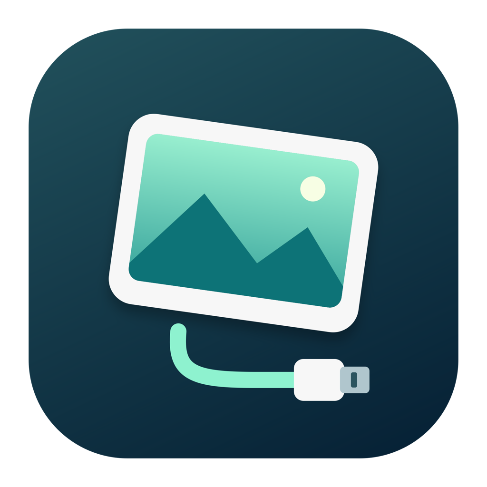

# GetMyFoto

Небольшое приложение для macOS: перенос фото и видео с iPhone по USB в обычную папку и удаление выбранных файлов с телефона.

**macOS 13 Ventura и новее · Apple Silicon и Intel · интерфейс на русском · версия 1.1.0**



## Установка

1. Скачайте `GetMyFoto-1.1.0-macOS-universal.zip` из [Releases](https://github.com/mikenimoff/GetMyFoto/releases).
2. Распакуйте архив и перенесите `GetMyFoto.app` в «Программы».
3. Закройте предыдущую версию GetMyFoto, если она открыта, и запустите новую.

Сборка имеет локальную ad-hoc подпись. Сертификат Apple Developer ID и нотариализация отсутствуют, поэтому macOS может заблокировать первый запуск скачанного приложения. После попытки запуска разрешить его можно через «Системные настройки → Конфиденциальность и безопасность → Всё равно открыть». [Инструкция Apple](https://support.apple.com/en-us/102445).

## Как перенести файлы

1. Подключите iPhone кабелем, который поддерживает передачу данных.
2. Разблокируйте iPhone, подтвердите «Доверять этому компьютеру» и доступ к фото, если появится запрос.
3. Дождитесь списка файлов. Для большой медиатеки это может занять несколько минут.
4. Если соединение зависло, нажмите «Обновить»: приложение обновит каталог, а для неготового соединения заново запустит поиск iPhone. Затем отметьте файлы или нажмите «Выбрать все». Фильтры и поиск помогают сузить список; «Выбрать все» действует на видимый список.
5. Выберите папку на Mac или внешнем накопителе и нажмите «Скопировать на Mac».

По умолчанию создаются папки `ГГГГ-ММ`; настройку можно отключить. Кнопка остановки завершает текущий файл, затем прекращает очередь. Отключение кабеля не затрагивает уже готовые копии. Миниатюры фото и видео появляются только для видимых строк; файлы не нужно импортировать для просмотра миниатюры. Одновременно выполняются не более трёх запросов, кэш в памяти ограничен 300 изображениями и 32 МБ. При уходе строки с экрана её незапущенный запрос отменяется. Если iOS не выдаёт миниатюру, остаётся значок типа файла. Превью не сохраняются на диск и не передаются в сеть.

Файлы с совпадающими именами получают суффиксы `(2)`, `(3)` — существующие файлы не перезаписываются. Перенос сначала идёт во временную скрытую папку внутри папки назначения; завершённый непустой файл перемещается на своё место. Успех передачи определяется ответом системного API. Побайтовое сравнение с оригиналом на iPhone не выполняется.

GetMyFoto записывает историю в `.getmyfoto-history.json` в папке назначения. При повторном импорте проверяются устройство, путь файла на устройстве, исходный размер и дата; у локальной копии проверяются наличие и размер. Это учёт собственных переносов приложения, а не поиск любых дубликатов на диске. Если копию переместить, удалить или изменить её размер, файл будет импортирован снова. Повреждённая история показывается как ошибка, а не заменяется молча.

## Как почистить iPhone

1. Сначала скопируйте нужные файлы и проверьте, что они открываются на Mac.
2. «Только сохранённые» выбирает файлы, для которых в выбранной папке найдены копии из истории GetMyFoto.
3. Нажмите «Удалить…». Проверьте список, количество и сведения о найденных копиях.
4. Поставьте отметку подтверждения и нажмите «Удалить N файлов».

Можно удалить и файлы без локальной копии: это отдельно видно в окне подтверждения. При подключении ничего не выбрано. Автоматического удаления после копирования нет. Отчёт показывает, что удалено, а что не удалось удалить.

**Удаление зависит от разрешений iOS.** Если телефон не сообщает поддержку удаления через Image Capture, кнопка недоступна. Некоторые конфигурации iCloud/синхронизации и защищённые файлы могут препятствовать удалению. Приложение показывает результат системного запроса и не обходит ограничения iOS.

При включённых «Фото iCloud» удаление может синхронизироваться с iCloud и другими устройствами. iOS может обрабатывать фото и связанную видеочасть Live Photo вместе. GetMyFoto не предоставляет отмену удаления. После очистки проверьте альбом «Недавно удалённые» на iPhone: для немедленного освобождения места может потребоваться очистить его вручную. [Как работает удаление в iCloud Photos](https://support.apple.com/en-us/108782).

## Форматы и ограничения

- Используется встроенный Apple ImageCaptureCore. Драйверы, установка приложения на iPhone и вход в Apple ID не нужны.
- Список содержит файлы, которые iOS выдаёт по USB, и доступные сопутствующие файлы. Это не доступ ко всему хранилищу телефона.
- HEIC, JPEG, RAW, MOV, MP4 и другие форматы сохраняются как файлы. Приложение само не конвертирует их; iOS может конвертировать медиа при передаче в зависимости от настройки «Перенос на Mac или ПК» на iPhone.
- Live Photo может экспортироваться как отдельные фото и видео. Для сохранения обеих частей выбирайте их обе. Это не импорт в медиатеку приложения «Фото».
- При «Оптимизации хранилища» в iCloud часть оригиналов может отсутствовать локально на телефоне. GetMyFoto не скачивает их из iCloud; сначала обеспечьте доступность оригиналов на iPhone.
- Приложение не загружает ваши медиа в сеть, не содержит аналитики и не сохраняет данные Apple ID. Ссылка на GitHub открывает браузер по нажатию.
- В редком случае аварийного завершения скрытая папка `.getmyfoto-transfer-*` может остаться в папке назначения. После выхода из приложения её можно удалить; она не содержит завершённых копий из истории.

## Сборка

Нужны macOS и Xcode Command Line Tools со Swift 5.9 или новее (проверено Swift 6.1.2, macOS 15.7.9).

```sh
xcode-select --install
git clone https://github.com/mikenimoff/GetMyFoto.git
cd GetMyFoto
bash build.sh
open dist/GetMyFoto.app
```

Скрипт выполняет проверки, компилирует `arm64` и `x86_64`, объединяет их в universal binary, создаёт иконку, Info.plist, ad-hoc подпись, ZIP и SHA-256. Результат находится в `dist/`. Сторонних библиотек и Swift Package-зависимостей нет.

## Версии и релизы

- `VERSION`: пользовательская версия по Semantic Versioning, например `1.0.0`.
- `BUILD`: целочисленный номер сборки, например `1`.
- Обе версии попадают в Info.plist, окно «О GetMyFoto», боковую панель и отчёт.
- `CHANGELOG.md`: история изменений.
- GitHub Actions собирает приложение и запускает проверки для pull request и push в `main`. Тег `vX.Y.Z`, совпадающий с `VERSION`, создаёт GitHub Release с ZIP и контрольной суммой.

## Проверка

```sh
bash scripts/test.sh
```

21 автоматическая проверка охватывает имена, коллизии, границы временной папки, историю, исчезнувшие и изменённые копии, а также сопоставление iPhone при замене объекта USB-драйвера. Они не выполняют операции на реальном iPhone.

Статус 1.1.0: код скомпилирован для обеих архитектур; проверены запуск, интерфейс и чтение списка с подключённого iPhone. Копирование, прерывание USB во время переноса и удаление на реальном iPhone пока не подтверждены. Перед массовой очисткой следует проверить полный цикл на нескольких ненужных файлах. Чек-лист: [docs/TESTING.md](docs/TESTING.md).

## Системные API

[Скачивание файла](https://developer.apple.com/documentation/imagecapturecore/iccamerafile/requestdownload(options:completion:)), [параметры скачивания](https://developer.apple.com/documentation/imagecapturecore/icdownloadoption), [удаление файлов](https://developer.apple.com/documentation/imagecapturecore/iccameradevice).

MIT License.
